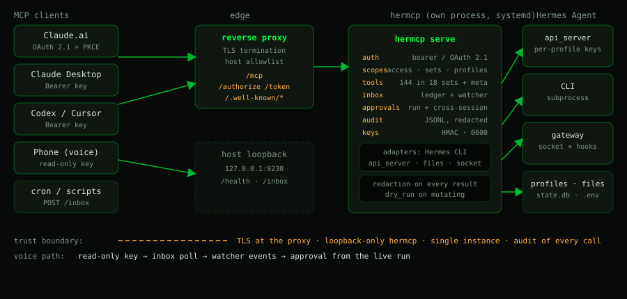

# hermcp — H.E.R.MCP

[](https://github.com/HearthCore/hermcp/actions/workflows/ci.yml)
[](LICENSE)
[](#requirements)

> **Unofficial community project.** hermcp is not affiliated with, endorsed by, or maintained by
> Nous Research. "Hermes Agent" is a product of Nous Research; this plugin only talks to an
> installed Hermes via its public CLI, Python modules and API server.

**Hermes Environment Remote MCP.** A Hermes Agent plugin that exposes the whole Hermes
control surface (models, config, sessions, cron, kanban, plugins, skills, profiles,
providers, approvals, secrets) as a **remote MCP server** with per-key scopes.

Point Claude.ai, Claude Desktop, Codex, Cursor or any MCP client at one URL and drive a
Hermes install from there — including from a phone, including OAuth logins for providers.

<p align="center">
  
</p>


> **Status: 0.1.0.** All four build phases are implemented and covered by tests. Today's catalog is
> **144 tools — 46 advertised in `tools/list`, the rest reachable through
> `hermes_search_tools` → `hermes_describe_tool` → `hermes_call`** — spread over 18 toolsets plus 4
> meta tools: per-key scopes, OAuth 2.1 for Claude.ai connectors, run-scoped, cross-session and
> hook-based approvals, client sessions, the event inbox with a run watcher, per-profile api_server
> keys, output redaction, audit. Known gaps are listed in [Roadmap](#roadmap).

## Why

Hermes already has a CLI (~380 leaf commands) and a dashboard API. Neither is an MCP
surface, and neither is built for scoped third-party access: a dashboard session cookie is
all-or-nothing, and shelling into the CLI means `SSH` and full trust.

hermcp wraps the same capabilities as **tools with explicit scopes**, so you can hand
someone a key that only speaks to one profile, only reads sessions, or only manages kanban —
and see everything they did in an audit log.

## What is confirmed working

Everything in this list is exercised by tests and/or by `hermes hermcp doctor` and `hermes hermcp
selftest` against a live install. Each row links to the section that documents it.

| Feature | What you get | Where |
|---|---|---|
| 145 tools, 19 toolsets | Full Hermes control surface behind one `/mcp` endpoint; 42 tools advertised, the rest through `hermes_search_tools` | [Tool surface](docs/tool-surface.md) |
| Trusted proxies | `HERMCP_TRUSTED_PROXIES`: forwarding headers (`X-Forwarded-For`/`Forwarded`/`X-Real-IP`/`-Proto`/`-Host`) are believed only from a configured proxy, read right to left; otherwise ignored entirely | [Reverse proxy](docs/deployment.md#trusted-proxies--the-only-place-forwarding-headers-are-believed) |
| Per-key scopes | `access` + `toolsets` + `profiles` + explicit flags (`approvals`, `secrets_write`, `dangerous`, `inbox_push`, `approvals_always`); hidden tools never appear in `tools/list` | [Keys and scopes](docs/keys-and-scopes.md) |
| Profile-bound keys | A key limited to one profile; global/admin tools and every indirect path (kanban, sessions, cron, skills, logs, approvals, inbox) closed | [Profile-bound keys](docs/profile-bound-keys.md) |
| Key lifecycle | `keys create / list / policy / show / revoke / rotate / rename / scopes`; rename and scope changes keep the token valid | [CLI](docs/cli.md) |
| OAuth 2.1 for Claude.ai | PKCE S256, exact redirect allowlist, hashed opaque tokens, paste-an-`hmcp_`-key consent page | [Claude.ai connector](docs/oauth.md) |
| Run-scoped approvals | Answer the approval of a run hermcp started (`chat_run_approval`) | [Approvals](docs/approvals.md) |
| Cross-session approvals | An in-gateway agent half publishes Telegram/CLI approvals on a loopback socket | [Approvals](docs/approvals.md) |
| Approval hooks | `pre_approval_request` / `post_approval_response` land in the inbox as `approval_pending` / `approval_resolved` | [Approval hooks](docs/inbox-and-runs.md#approval-hooks-telegram-and-cli-approvals-in-the-inbox) |
| Starting and steering runs | `chat_send` (idempotent via `request_key`), `chat_run_steer`, `chat_run_cancel`, `chat_session_queue` | [Starting runs](docs/inbox-and-runs.md#starting-runs-chat_send) |
| Client sessions | Session cards, `client_session` handles, run attribution, foreign-run guard, `recover_from`, claim of unclaimed runs, situation report | [Client sessions](docs/client-sessions.md) |
| Cron ledger | `cron_runs` (lean metadata from `executions.db`) and `cron_run_output` (full saved output by run id, paged, redacted); session attribution, scope filtering, untrusted marking | [Cron ledger](docs/tool-surface.md#cron-ledger) |
| Event inbox + run watcher | Status-only mailbox with per-consumer read state; the watcher turns run status into `needs_approval` / `run_finished` / `run_failed` / `run_cancelled` / `run_lost` / `run_interrupted` | [Event inbox](docs/inbox-and-runs.md) |
| One attention classification | `inbox_attention` and `hermes_status.inbox` share one decision: waiting approvals, open failures, interruptions, settled failures (with `settled_reason` / `superseded_by`), decided approvals with their decision protocol | [Ledger](docs/ledger.md#eine-wahrheit-für-seite-und-tools) |
| Per-profile api_server keys | `profile-keys status / setup / rotate`, never printing a key | [Per-profile api_server keys](docs/profile-keys.md) |
| Output redaction | Every result and audit line redacted centrally; write tools return changes, never values | [Output redaction](docs/tool-surface.md#output-redaction) |
| Single instance + lifecycle | `flock`-guarded single server, `status`, `stop`, `install-service`, self-restart, auto-restart after a Hermes update | [Single instance](docs/install.md#single-instance) |
| Dashboard control | `dashboard_status` / `dashboard_restart` find and restart exactly the running dashboard | [Dashboard control](docs/dashboard-control.md) |
| Ledger page (opt-in) | Read-only situation page on hermcp's own port, terminal-styled and with a real navigation: `~/attention` (KPI strip, open approvals, open failures, gateway), `~/sessions`, `~/runs` (incl. settled failures and the approval history with its decision protocol), `~/cron`, `~/gateway`, and `/ledger/session/<id>` for one session wide; the attention panel collapses to a single `✓ zero active interruptions` line when nothing is open, and every entry offers "✦ Ask Claude" — a plain link that opens Claude with a prepared question (ids only, details read via the tools). Every row opens a small detail pop-up; no write path anywhere, deep links into the Desktop/Web app, own stylesheet and fonts (no external request). Growing lists on the start page show a server-side window (default 10, `HERMCP_LEDGER_*_LIMIT`) with “Mehr anzeigen” | [Ledger](docs/ledger.md) |
| Audit | Append-only JSONL with key id, tool, profile, duration, outcome | [Keys and scopes](docs/keys-and-scopes.md) |

## Requirements

- Hermes Agent installed with its virtualenv (examples below use `/usr/local/lib/hermes-agent/venv`; adjust to your install)
- Python ≥ 3.11 (the Hermes venv is used; nothing is installed into it)
- A reverse proxy with TLS for anything beyond loopback (the reference setup uses Pangolin/Traefik; any TLS proxy works)
- No third-party Python dependencies: the code uses **stdlib + what Hermes already ships**
  (`starlette`, `uvicorn`, `mcp`)

## Install

Five steps. On a local install the `.env` is optional — the defaults are `127.0.0.1:9230`
and an api_server on `127.0.0.1:8642`.

```bash
# 1. clone it (the folder name must be `hermcp`)
git clone https://github.com/HearthCore/hermcp.git ~/.hermes/plugins/hermcp
cd ~/.hermes/plugins/hermcp

# 2. enable the plugin — this registers the `hermes hermcp` command
hermes plugins enable hermcp

# 3. create the runtime env if you need one (mode 0600); see docs/install.md for the values
cp .env.example .env 2>/dev/null || true

# 4. run it as a service (must live outside the gateway's process tree)
hermes hermcp install-service
systemctl enable --now hermcp

# 5. first key + smoke test
hermes hermcp keys create --name admin-key --access admin   # prints hmcp_<id>_<secret> ONCE
hermes hermcp doctor
curl -fsS http://127.0.0.1:9230/health
```

Point a client at `http://127.0.0.1:9230/mcp` (locally) or `https://<host>/mcp` (behind a TLS
proxy) with `Authorization: Bearer hmcp_<...>`. Read-only first is the sane default:

```bash
hermes hermcp keys create --name readme-readonly --access read \
  --toolsets status,sessions --profiles default
```

Full detail — `.env` values, the two systemd managers, the polkit rule, auto-restart after a
Hermes update and the single-instance lock — is in **[docs/install.md](docs/install.md)**.

## Setup with an agent

Start your coding agent (Claude Code, Codex, Cursor, ...) inside this folder and say
"set up hermcp": it loads [`AGENTS.md`](AGENTS.md) and walks you through preflight, install,
keys, client setup and verification. Claude Code reads it via `CLAUDE.md`, which only points there.
Secrets stay with you — the agent is instructed to hand you every command that prints a key.
The AGENTS.md flow has been run step by step with GitHub Copilot CLI (per the author's report, including
with unclear user input); any agent that loads `AGENTS.md` should work.

## The `hermes hermcp` CLI

`hermes plugins enable hermcp` registers one sub-command. Day to day that is four calls:

```bash
hermes hermcp keys list                       # who has which scopes
hermes hermcp keys show alice-researcher      # what one key may do
hermes hermcp keys scopes alice-r2 --toolsets status,sessions --no-approvals
hermes hermcp doctor                          # after any config change
```

Everything else — `serve`, `status`, `stop`, `install-service`, `selftest`, `docs`, `oauth`,
`profile-keys`, the full `keys` family and the exit-code contract — is in
**[docs/cli.md](docs/cli.md)**.

## Tool surface

**144 tools in 18 toolsets, 46 advertised directly.** Models (and especially voice modes) degrade
with huge tool lists, so the long tail is reachable through three meta tools:

```
hermes_search_tools(query) -> hermes_describe_tool(name) -> hermes_call(name, args)
```

`hermes_call` re-runs the full scope check, so it cannot reach a tool the key may not use.
`hermes_status` is the level-0 entry point; every mutating tool accepts `dry_run: true`.

Browse the whole surface — every schema and the exact `initialize` instructions — in
**[docs/tools.html](docs/tools.html)**, generated from the live registry on every server start.
The prose version (toolsets, notable tools, list defaults, cron routing, output redaction) is
**[docs/tool-surface.md](docs/tool-surface.md)**.

## Security model

What this protects against: a leaked or scoped key doing more than its scope; a tool call
reaching an unintended profile; silent credential exposure (write-only secrets, redacted
audit, hashed key storage); DNS-rebinding and Host-header confusion; brute force on tokens
(per-IP failed-auth limiter).

What it does **not** do: protect against an admin-scoped key. `access: admin` with
`toolsets: *` is effectively shell on the Hermes install — treat such keys like SSH root
keys, and rotate them.

## Documentation

| Document | What it holds |
|---|---|
| [docs/install.md](docs/install.md) | `.env`, the systemd managers, service units, auto-restart, single instance |
| [docs/cli.md](docs/cli.md) | every command and the exit-code contract |
| [docs/keys-and-scopes.md](docs/keys-and-scopes.md) | scopes, admin keys, worked examples |
| [docs/tool-surface.md](docs/tool-surface.md) | catalog, meta tools, server instructions, redaction |
| [docs/tools.html](docs/tools.html) | generated catalog with every schema |
| [docs/inbox-and-runs.md](docs/inbox-and-runs.md) | inbox, run watcher, approval hooks, `chat_send`/steer/cancel |
| [docs/client-sessions.md](docs/client-sessions.md) | `client_session` ledger, recovery, claims |
| [docs/approvals.md](docs/approvals.md) | how approvals work inside Hermes, run-scoped and cross-session |
| [docs/provenance.md](docs/provenance.md) | `_meta`, freshness and the selftest |
| [docs/profile-bound-keys.md](docs/profile-bound-keys.md) | what a profile-bound key may call |
| [docs/profile-keys.md](docs/profile-keys.md) | per-profile `API_SERVER_KEY` resolution |
| [docs/oauth.md](docs/oauth.md) | OAuth 2.1 for Claude.ai connectors |
| [docs/deployment.md](docs/deployment.md) | reverse-proxy route (Pangolin/Traefik), env values |
| [docs/dashboard-control.md](docs/dashboard-control.md) | `dashboard_status` / `dashboard_restart` |
| [docs/troubleshooting.md](docs/troubleshooting.md) | known symptoms |
| [docs/development.md](docs/development.md) | tests, repo layout, environment traps |
| [docs/DESIGN.md](docs/DESIGN.md) | design contract (architecture, hard constraints) |
| [docs/cli-parity.md](docs/cli-parity.md) · [docs/CLI_INVENTORY.md](docs/CLI_INVENTORY.md) | CLI to tool parity table, command inventory |
| [AGENTS.md](AGENTS.md) | agent-guided setup: start your coding agent here |

## Roadmap

- [x] Key store, scopes, audit, meta tools, 140 tools across 18 toolsets
- [x] Single-instance lock, systemd migration path, status/stop/install-service
- [x] Remote provider OAuth (device code / paste-back), write-only secrets
- [x] OAuth 2.1 authorization server for Claude.ai custom connectors (persistent hashed tokens)
- [x] In-gateway agent half: cross-session approval bridge over a loopback socket
- [x] Run-scoped approvals (`/v1/runs` contract), `dangerous` scope, memory, audit tools
- [ ] Not yet exposed (deliberately): `debug share`, `backup`, `import`, `uninstall`, `gateway
      migrate/uninstall`, `profile purge-identity` — they would need the `dangerous` scope
- [ ] Clarify prompts (`PendingControls`) are not bridged, only command approvals
- [ ] Two or three levels instead of many commands: the default becomes a short list of the last five
      to ten entries (configurable through a plugin option), and whoever wants more goes into the
      detail view. Briefly recent "relevant noise" should stay visible for a while — deliberately not
      built yet, the slim attention-only default is the first step.
- [ ] Live verification of the agent half inside a real gateway (needs the gateway restart)
- [ ] `hermes plugins install` from this repo

## Contributing and security

See [CONTRIBUTING.md](CONTRIBUTING.md) and [CODE_OF_CONDUCT.md](CODE_OF_CONDUCT.md). Report
vulnerabilities privately via GitHub's *Report a vulnerability* button, see [SECURITY.md](SECURITY.md).

## License

MIT — see [LICENSE](LICENSE).
