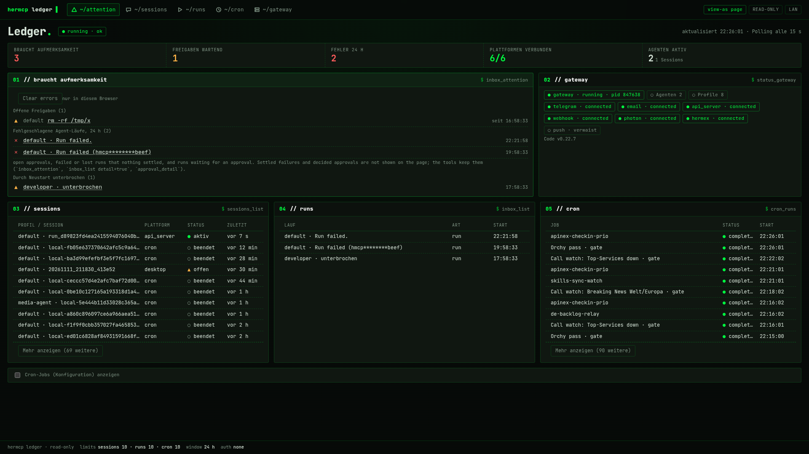
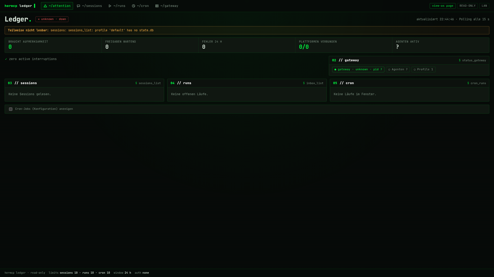
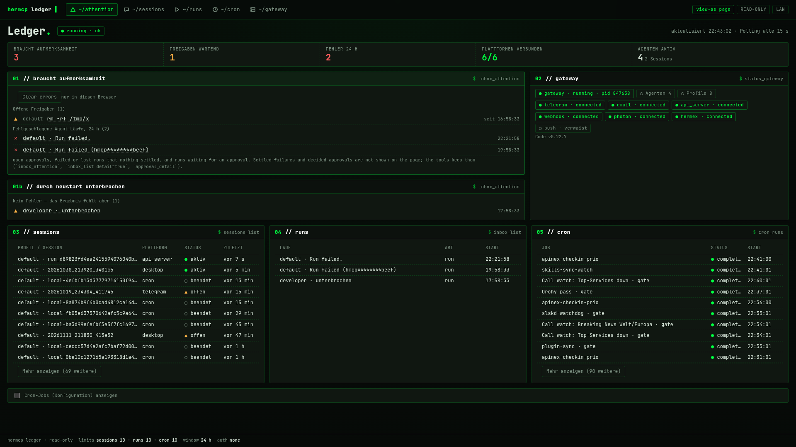
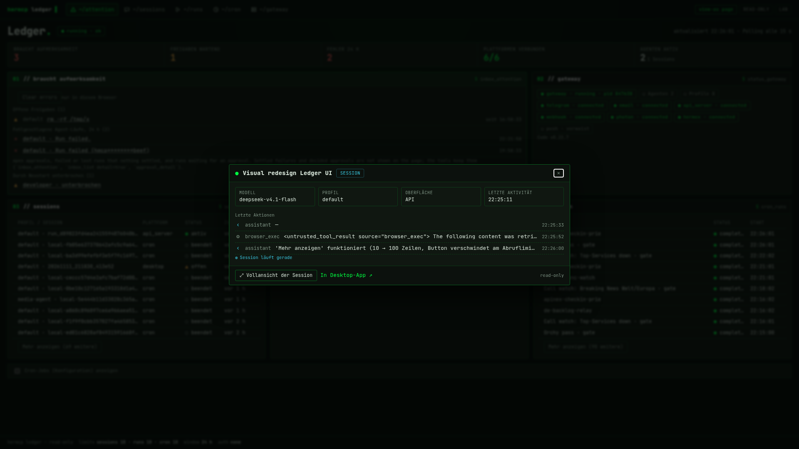
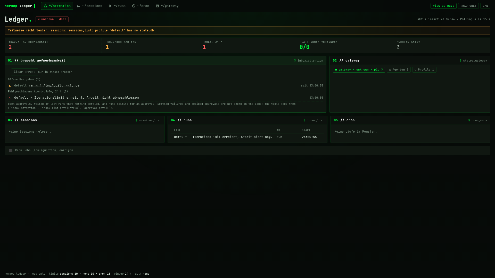
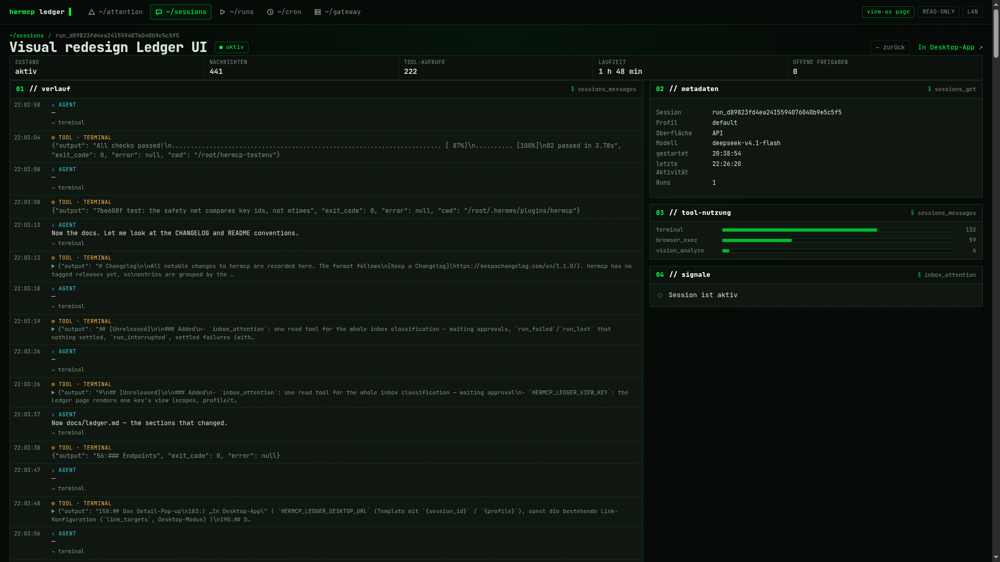
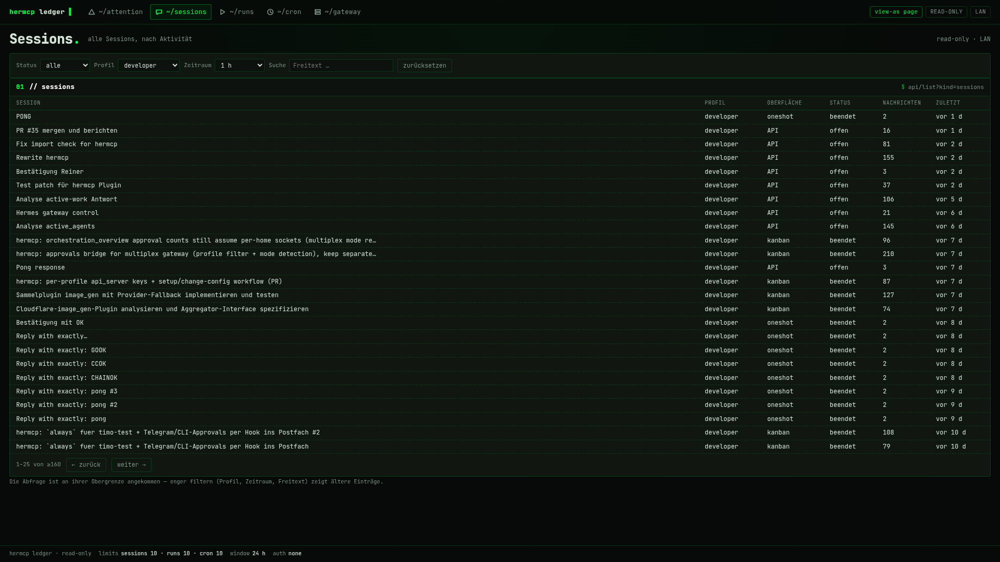

# hermcp Ledger — read-only situation page (opt-in)

One page that answers "what is going on right now" for this Hermes install, served by hermcp
itself on the same port. It is **opt-in and off by default**: without `HERMCP_LEDGER=1` the routes
do not exist (they 404).

Five pages share one shell and one stylesheet:

| Route | What it is |
|---|---|
| `/ledger` | `~/attention` — the start page: system status, five KPIs, the attention panel, gateway, and the three list panels (sessions, runs, cron) |
| `/ledger/sessions` | all sessions, paged, filterable |
| `/ledger/runs` | run history: open failures, restart interruptions, settled failures with what settled them |
| `/ledger/cron` | the cron ledger, paged, filterable |
| `/ledger/gateway` | platform state, versions, profiles, key overview (no secrets) |
| `/ledger/session/<id>` | one session wide: history, metadata, tool usage, signals |



*Die Startseite (`~/attention`) bei 1920×1080 — ohne Scrollen bei den Standardlimits.*

The look is the terminal style of the portfolio: near-black `#070a08`, green `#00ff41`, amber for
waiting, red for errors, cyan for running, hairline green rules, scanlines and a soft glow from the
top. Panel titles read `01 // titel` with the tool that fed them on the right (`$ inbox_attention`).
Symbols carry the state so colour is never the only signal: `●` ok, `✕` error, `◌` running, `▲`
waiting/approval, `○` finished, `›` user, `‹` agent, `⚙` tool.



*Nichts offen: kein Panel, keine Leerlisten, kein „Clear errors" — eine Zeile, und die Listen rücken hoch.*



*Sobald etwas offen ist, steht das Panel wieder da — unverändert, inklusive „Clear errors" (nur im Browser).*

**Wenn nichts offen ist**, wird das Attention-Panel gar nicht gezeichnet: kein Rahmen, keine leeren
Listen, kein „Clear errors" — nur eine gedimmte Zeile `✓ zero active interruptions`, die den Platz an
die Listen darunter freigibt. Sobald irgendetwas offen ist (Fehler, Unterbrechung, wartende Freigabe
oder in diesem Browser ausgeblendete Zeilen), erscheint das Panel unverändert. Dasselbe gilt für den
Unterbrechungsblock, der sein eigenes Panel (`panel-interrupted`) hat. Die Kopfzähler bleiben in
beiden Fällen identisch zu `hermes_status`.

Fonts and stylesheet come from hermcp itself (`/ledger/assets/app.css`,
`/ledger/assets/fonts/…`): JetBrains Mono and Sora as latin `woff2` subsets under the SIL Open Font
License (see `ledger_assets/fonts/OFL.txt`, ~65 KB together). **No external request** — the page is
meant for a LAN and must not call out to a font CDN. Without the files the CSS falls back to
`ui-monospace` / `system-ui`.

Layout target is **1920×1080**: the start page fits without scrolling at the default list windows
(10 rows each). Below ~1280px panels stack, below ~760px everything is one column and tables scroll
horizontally.

Not to be confused with the **cron ledger** (`cron_runs` / `cron_run_output`): that is a tool for
run records, this is a page. The module is `hermcp/ledger_page.py` for the same reason.

```bash
# in the hermcp runtime env (mode 0600), or the unit's Environment=
HERMCP_LEDGER=1
HERMCP_LEDGER_AUTH=none     # no key needed; only private/loopback clients are served
systemctl restart hermcp
```

Open `http://<hermcp-host>:9230/ledger`.

## Two auth modes

| `HERMCP_LEDGER_AUTH` | What it does |
|---|---|
| `key` (default) | the page needs a hermcp key: `/ledger?key=hmcp_…` is answered with a 303 to `/ledger` and an HttpOnly cookie, so the key never stays in the URL or the history. The JSON endpoints also accept a normal `Authorization: Bearer` header. |
| `none` | no key and no cookie at all — but only for **private/loopback clients**. |

`none` is for the trusted case: a read-only page on a port that is already only reachable from your
own network. It is **not** a way to publish the page: see the guard below.

### Endpoints

| Endpoint | Payload |
|---|---|
| `GET /ledger/overview` | everything the start page draws (sections fail independently) |
| `GET /ledger/api/peek?kind=&id=` | the pop-up: `kind` is `session`, `run`, `cron` or `approval`; optional `profile`, `job` |
| `GET /ledger/api/list?kind=` | `sessions`, `runs`, `approvals` or `cron`; `offset`, `limit`, `status`, `profile`, `surface`, `state`, `job`, `hours`, `q` |
| `GET /ledger/api/session/<id>` | the session full view (optional `profile`) |
| `GET /ledger/api/gateway` | platform state, versions, profiles, keys without secrets |
| `GET /ledger/jobs` | the cron job configuration (behind the toggle on the start page) |
| `GET /ledger/assets/app.css`, `/ledger/assets/fonts/<name>` | stylesheet and the two font subsets — a fixed whitelist, never a path from the request |

Every JSON endpoint takes the same credential as the page (cookie, `?key=` once, or a bearer
header) and renders the same view key. A key without read access on a tool gets that section
reported as unavailable, not an error page.

### The network guard (`AUTH=none` only)

A request is served only when the client address is loopback, RFC1918 (`10/8`, `172.16/12`,
`192.168/16`), CGNAT/Tailscale (`100.64/10`), an IPv6 ULA (`fc00::/7`) or IPv6 link-local
(`fe80::/10`). Everything else gets **403**:

* a public client address;
* **any** request carrying `X-Forwarded-For`, `Forwarded`, `X-Real-IP`, `CF-Connecting-IP` or
  `True-Client-IP`. Behind a reverse proxy the client address is the proxy's, and without a
  configured trusted proxy hermcp cannot tell a private client from a public one — so it refuses
  instead of opening. Adding a trusted-proxy allowlist is deliberately left for later;
* a request whose client address is unknown.

The ranges are listed explicitly rather than taken from `ipaddress.is_private`, which also calls
documentation ranges such as `203.0.113.0/24` private.

**Requests through a trusted proxy are served**: with `HERMCP_TRUSTED_PROXIES` set, the client
address comes from the proxy's forwarding chain (right to left, first untrusted address), and a
request that arrives through such a proxy is treated as authenticated by it — that is where Pangolin
SSO sits. Direct requests from public addresses stay refused.

The trade is explicit: **whoever turns off the proxy's auth for the `/ledger` route publishes it.**
hermcp cannot distinguish an authenticated from an unauthenticated proxy request; it trusts the
proxy for that decision. Keep the trusted list to exact proxy addresses (not subnets), keep the
route behind the proxy's auth, and see
[deployment.md](deployment.md#trusted-proxies--the-only-place-forwarding-headers-are-believed).

`none` is **safe only inside a trusted network**. Never put it behind an edge that does not strip or
overwrite forwarding headers, and never forward the port to the internet.

### Deprecated (one-day) names

The page shipped for one day as "Lagebild". These still work and are read only where the new name is
unset — **the new name always wins**:

| Old (deprecated) | New |
|---|---|
| `HERMCP_LAGEBILD` | `HERMCP_LEDGER` |
| `HERMCP_LAGEBILD_AUTH` | `HERMCP_LEDGER_AUTH` |
| `HERMCP_LAGEBILD_BASE_URL` | `HERMCP_LEDGER_BASE_URL` |
| `HERMCP_LAGEBILD_POLL_SECONDS` / `_WINDOW_HOURS` / `_CACHE_TTL` | `HERMCP_LEDGER_…` |
| `/lagebild`, `/lagebild/overview`, `/lagebild/jobs` | 308 to `/ledger…` |

### Outlook: OIDC instead of a key in the browser

The key mode exists because hermcp has no user model yet: the alternative today would be a key
stored in a browser. The intended direction is per-user OIDC for the page (sign-in against the
existing identity provider, a principal per user, scopes from groups) so `AUTH=key` can go away for
humans and `AUTH=none` stays what it is: a private-network convenience. Not implemented yet.

## Aufräumen in der Ansicht (nur im Browser)

Fehler verschwinden nicht sofort, nur weil sie erledigt sind. Die Seite bietet deshalb einen rein
lokalen Aufräum-Weg — **ohne Schreibpfad**:

* **Ausblenden** pro Eintrag, plus „Alle ausblenden“ im Block. Der Zustand liegt in
  `localStorage` (`hermcp.ledger.dismissed.v1`, Schlüssel = Run-ID), also **pro Browser** und nicht
  serverseitig. Ist der Speicher nicht verfügbar (privater Modus, Richtlinie), sagt die Seite das und
  das Ausblenden gilt nur für die aktuelle Ansicht. Beim Laden werden IDs, die das Zeitfenster
  verlassen haben, aus dem Speicher entfernt (kein Wildwuchs). Eine Zeile „N ausgeblendet“ bietet
  „anzeigen“/„wieder einblenden“ und „Zurücksetzen“. Ausblenden zählt nichts doppelt und holt keinen
  serverseitig erledigten Eintrag als Fehler zurück: die Kopfzähler kommen aus dem Digest des Servers,
  der Browser zieht nur ab, was er selbst ausgeblendet hat.

**Offene Freigaben lassen sich nicht ausblenden** — sie sind actionable; das ist Absicht.

### Was die Seite nicht mehr zeigt

Die Seite ist eine Sicht auf **offene Arbeit**, kein Archiv. Deshalb sind entfernt:

* die eingeklappte Gruppe „Erledigt“ (gesettlete Fehlschläge mit `settled_reason`, überholte
  Cron-Fehler, `operator_backfill`-Zeilen),
* die „Freigabe-Historie“ (entschiedene Freigaben mit Oberfläche, Zeitpunkt und verlorenen
  Zweitversuchen).

Die Daten bleiben unverändert in der Inbox-Datenbank und sind über die MCP-Tools erreichbar:
`inbox_list detail=true`, `inbox_attention` (liefert `settled` und `history` weiter) und
`approval_detail`. `run_interrupted` behält seinen ruhigen Block nur, solange der Lauf der offene
Zustand seiner Session ist — hat dieselbe Session danach einen terminalen Lauf (beendet, fehlgeschlagen
oder erneut unterbrochen), ist die Unterbrechung Historie und verschwindet von der Seite; in der Inbox
bleibt sie lesbar.

Die Zähler oben („Fehlschläge 24 h“, „Braucht Aufmerksamkeit“) rechnen ausgeblendete Einträge heraus.
Es gibt dafür keinen Endpunkt: die Seite bleibt strukturell read-only, der Principal bleibt
`access=read`, nichts an Hermes-Daten (Cron-Ledger, Sessions, `executions.db`) wird geändert.

## Das Detail-Pop-up

Jede Zeile im Attention-Bereich und in den Listen ist ein `<button>`. Ein Klick öffnet ein
zentriertes modales `<dialog>` (Breite ~820px, dunkler Backdrop, `role=dialog`, Esc und Klick auf den
Backdrop schließen, Fokus-Trap, Fokus kehrt danach auf die auslösende Zeile zurück). Inhalt bewusst
klein:

* Kopf: Symbol, Titel, Art-Chip (SESSION / RUN / CRON / FREIGABE WARTET / FREIGABE ENTSCHIEDEN /
  CRON-FEHLER), ✕
* vier Eckdaten: Modell, Profil, Oberfläche, letzte Aktivität
* die letzten drei Aktionen mit Uhrzeit (Rolle, Text gekürzt); ein Live-Hinweis nur bei laufender
  Session
* Fußzeile: „⤢ Vollansicht der Session" (`/ledger/session/<id>`), „↗ In Desktop-App", „↗ In Web-App",
  Hinweis `read-only`



*Das Pop-up: bewusst klein — vier Eckdaten, die letzten drei Aktionen, Links. `Esc` und Klick auf den
Backdrop schließen, der Fokus kehrt auf die Zeile zurück.*

Die Daten kommen aus `GET /ledger/api/peek?kind=&id=` — gleiche Schicht, gleiche Scope-Prüfung,
gleicher View-Key wie der Rest der Seite. Texte werden **serverseitig** gekürzt (Aktionen 160
Zeichen, Tool-Ausgaben 220), Secrets über `redact_text` maskiert (dieselbe Maskierung wie die
Read-Tools); rohe Tool-Ausgaben gehen nie ungekürzt raus. Ein gelöschter Eintrag ergibt einen
lesbaren Fehlerzustand im Dialog (`ok:false` + Satz), keinen Absturz.

### Desktop- und Web-App-Links

| Ziel | Quelle |
|---|---|
| „In Desktop-App" | `HERMCP_LEDGER_DESKTOP_URL` (Template mit `{session_id}` / `{profile}`), sonst die bestehende Link-Konfiguration (`link_targets`, Desktop-Modus) |
| „In Web-App" | `HERMCP_LEDGER_WEB_URL` (gleiches Template), sonst `dashboard.public_url` im Dashboard-Modus |
| kein Button | nichts konfiguriert — der Button wird nicht gerendert |

Nur `http(s)`-Adressen werden verwendet; ein Template ohne `{session_id}` oder mit anderem Schema
ergibt keinen Link. Es sind reine Links, keine Aktionen.

### „✦ Ask Claude"

Im Pop-up (Fußzeile) und in der Session-Vollansicht (Kopfzeile) steht neben den App-Links ein
Button **✦ Ask Claude**. Er ist ein reiner Link (`target="_blank"`, `rel="noopener noreferrer"`,
Tooltip „öffnet Claude mit vorbereiteter Frage") — die Ledger-Seite sendet nichts, bestätigt nichts
und schreibt nichts.

Die Frage wird **serverseitig** gebaut, je Art des Eintrags:

| Art | Frage |
|---|---|
| Freigabe wartend | Risiko des Befehls einordnen (Befehl nur gekürzt und maskiert), Empfehlung `once` / `session` / `deny` mit Begründung, ausdrücklich „Nicht selbst antworten, nur beraten." |
| `run_failed` / Iterationslimit | Ursache, ob die Arbeit vollständig ist, was offen blieb, ob ein Weiterlaufen in derselben Session sinnvoll ist |
| `run_interrupted` | was unterbrochen wurde, ob neu gestartet werden sollte |
| Cron-Fehler / Cron | was passiert ist, ob noch etwas offen ist, ob sich ein Muster über die letzten Läufe zeigt |
| Session / Run | Zusammenfassung, offene Punkte, nächste Schritte |



*Der Button in der Fußzeile des Pop-ups — ein Link, kein Aufruf; der Tooltip erklärt, was er tut.*

Jede Frage nennt die IDs (Session, Run, Approval, Job), Art, Status, Zeiten, Profil und Oberfläche und
fordert Claude auf, die Details selbst über die hermcp-Tools zu lesen (`hermes_status`,
`inbox_attention`, `approval_detail`, `chat_run_status`, `sessions_messages`) — statt Inhalte in den
Link zu schreiben.

**Was im Link stehen darf** (und was nicht): nur IDs, Art, Status, Zeiten, Profil/Oberfläche und
höchstens ein auf 120 Zeichen gekürzter, maskierter Befehlsanfang. Keine Nachrichteninhalte, keine
Tool-Outputs, keine Secrets, Keys oder Tokens. Die Gesamtlänge der URL ist auf ~1800 Zeichen begrenzt
(der Befehlsanfang ist vorher schon kurz); reicht der Platz nicht, kürzt hermcp den Prompt am Ende und
markiert das mit `…`. Ist das Haupt-Template leer, wird der Button gar nicht gerendert.

## Die Session-Vollansicht

`/ledger/session/<id>` funktioniert für Sessions, für Runs (deren `session_id`) und für Cron-Läufe
(deren Session) gleichermaßen: Breadcrumb, Titel, ein Stat-Streifen (Zustand, Nachrichten,
Tool-Aufrufe, Laufzeit, offene Freigaben), links der Verlauf (Zeit, Rolle, Text; Tool-Aufrufe als
eigene Zeilen, Ergebnisse gekürzt und ausklappbar), rechts Metadaten (Session, Profil, Oberfläche,
Modell, gestartet, letzte Aktivität, Runs), die Tool-Nutzung als einfache Balken und die Signale
(offene Freigabe, Fehler im Verlauf, letzte Aktivität). Dazu `← zurück` und die beiden App-Links.



*Die Session-Vollansicht — links der Verlauf (Tool-Aufrufe als eigene Zeilen), rechts Metadaten,
Tool-Nutzung und Signale.*

Die Ansicht ist ebenfalls read-only und folgt demselben Seam: `sessions_get`, `sessions_messages` und
die eigene Inbox-Datenbank (Run-Watches, offene Freigaben) mit `access="read"`. Nachrichten- und
Tool-Texte werden redigiert und gekürzt, bevor sie den Prozess verlassen.

## Listen: Fenster statt Vollausgabe

Alle Listen, die wachsen können, sind **serverseitig** begrenzt:

| Liste | Einstellung | Default |
|---|---|---|
| Cron-Läufe | `HERMCP_LEDGER_CRON_LIMIT` | `HERMCP_LEDGER_LIST_LIMIT` |
| Sessions | `HERMCP_LEDGER_SESSIONS_LIMIT` | `HERMCP_LEDGER_LIST_LIMIT` |
| Run-Listen (offene Fehlschläge, Unterbrechungen) | `HERMCP_LEDGER_RUNS_LIMIT` | `HERMCP_LEDGER_LIST_LIMIT` |



*Eine Unterseite mit Filter (`~/sessions`, Profil `developer`). Die Historie liegt hier, nicht auf der
Startseite; der Pager zeigt `≥ N`, wenn das serverseitige Fenster voll war.*

`HERMCP_LEDGER_LIST_LIMIT` (Default 10) ist der gemeinsame Default; ein per-Liste gesetzter Wert
gewinnt. Erlaubt sind 3 bis 100 — ein Wert außerhalb dieses Bereichs oder etwas, das keine Zahl ist,
fällt auf den Default zurück und wird im Log genannt (`hermcp.settings`). Der Server schickt nur das
Fenster plus `total`, `has_more` und `more_count`; „Mehr anzeigen (N weitere)“ lädt den Rest über
`/ledger/overview?more=cron,sessions,runs` nach — die Liste wird also beim Ausklappen erneut
serverseitig gelesen und nicht im Browser abgeschnitten. Mehr als die Abrufgrenze (100 Zeilen je
Liste, 200 Fehlschläge im Attention-Teil) liefert auch das Ausklappen nicht; das steht als
`capped`/`truncated` im Payload.

**Ausblick:** Sobald es eine Authentifizierung pro User gibt (OIDC, siehe oben), kann ein
serverseitiges Quittieren pro User und Eintrag dazukommen — dann würde das Ledger selbst aufräumen und
der Zustand wäre geräteübergreifend. Nicht Teil dieser Version.

## Eine Wahrheit für Seite und Tools

Der Ledger entscheidet **nicht selbst**, was Aufmerksamkeit ist. Diese Entscheidung liegt an genau
einer Stelle — `adapters/attention.py` (Einstufung, Text, Zähler) und `Inbox.attention_view()` (die
Abfrage) — und wird von beiden Seiten benutzt:

* die MCP-Tools `hermes_status` (`inbox.failed_runs_24h`, `inbox.approvals_waiting`), `inbox_poll`,
  `inbox_list` und das neue `inbox_attention`;
* die Ledger-Seite, die für ihren Attention-Teil `inbox_attention` aufruft.

Gleiche Einstufung, gleiche Zähler, gleiche Filter, gleiche Profil-/Scope-Sicht wie ein Read-Key,
gleiche Texte. Ein Test (`tests/test_attention_parity.py`) hält das fest: für dieselben Daten müssen
Seite und Digest dieselben Zahlen liefern.

| Einstufung | Was hineinfällt | Wo es erscheint |
|---|---|---|
| `waiting` | Freigabe, die noch auf einen Menschen wartet | Attention-Bereich (nicht ausblendbar) |
| `attention` | `run_failed` / `run_lost` ohne `settled_reason`, vom Consumer nicht quittiert | Attention-Bereich |
| `interrupted` | `run_interrupted` — ein Neustart hat den Lauf nach vorhandener Ausgabe beendet | eigener ruhiger Block „Durch Neustart unterbrochen“, kein Fehler |
| `settled` | Fehlschlag mit `settled_reason` (`superseded_by_completed`, `superseded_by_failure`, `operator_backfill_*`) | **nicht auf der Startseite**; `/ledger/runs`, `inbox_attention`, `inbox_list detail=true` |
| `history` | Freigabe mit Entscheidung (`approved`, `denied`, `expired`) | **nicht auf der Startseite**; `/ledger/runs` (Freigabe-Verlauf), `inbox_attention`, `approval_detail` |
| `noise` | `run_finished`, `run_cancelled`, rohe Hook-Paare | nur über `inbox_list` / `detail=true` |

Die Seite zeigt nur, was noch Arbeit ist: ein erledigter Fehler verlässt Attention-Bereich und Zähler;
auf der Seite erscheint er nicht mehr, in den Tools bleibt er mit dem Vermerk lesbar, was ihn erledigt hat.

## Die Sicht eines Keys (`HERMCP_LEDGER_VIEW_KEY`)

Im Single-User-Betrieb soll die Seite dasselbe zeigen wie der Agent, der sie liest. Dafür gibt es
`HERMCP_LEDGER_VIEW_KEY`: der **Wert ist die Key-ID, nie das Token**. Ist sie gesetzt, rendert der
Ledger exakt die Sicht dieses Keys — Scopes, Profil- und Toolset-Filter, `deny_tools` und den
Gelesen-Stand (Consumer) dieses Keys — über dieselbe gemeinsame Abfrageschicht wie die MCP-Tools.
Ohne die Option bleibt es beim bisherigen Verhalten (read-only-Ansichts-Principal ohne Admin-Rechte).

Ist die ID unbekannt, der Key deaktiviert oder abgelaufen, zeigt die Seite eine klare Fehlermeldung
(HTTP 503, `view_key_unusable`) und **fällt nicht** auf eine breitere Sicht zurück. Ein Key-*Name*
wird bewusst nicht aufgelöst — nur die ID.

> **Warnung — bewusste Entscheidung im LAN, vor jeder Freigabe neu bewerten.**
> Mit einem **Admin-Key** als View-Key zeigt `/ledger` jedem, der die Seite erreicht, **alles, was
> dieser Key sieht** — inklusive aller Profile. Das ist im Single-User-LAN-Betrieb absichtlich so.
> Vor dem Freigeben über Pangolin oder eine andere Route muss das zusammen mit
> `HERMCP_LEDGER_AUTH` neu bewertet werden: die Seite erbt dann die Reichweite des Keys, und wer die
> Route erreicht, erbt sie mit. Der Ledger bleibt dabei strikt read-only (keine Aktionen, kein
> Schreiben von Gelesen-Stand durch die reine Anzeige).

## Read-only, by construction

Every value comes from the registry's existing **read** tools, invoked with a principal derived from
the caller's key — or, with `AUTH=none`, a fixed internal one — always forced to `access="read"`
(`ledger_page.read_only_principal`). Write and admin tools
are refused by the same scope model that guards `/mcp`, so "this page cannot act" is a property of the
seam, not of the buttons. There is no approve, start, stop, retry or config path anywhere in it.

| Section | Tools |
|---|---|
| Gateway state, version, active agents, every platform and stale writers | `status_gateway`, `hermes_status` |
| Pop-up of one entry: facts, last three actions, links | `sessions_get`, `sessions_messages`, `cron_runs`, `approval_detail`, inbox run watches |
| Session full view | `sessions_get`, `sessions_messages`, inbox run watches and open approvals |
| Sub-pages (sessions/runs/cron/approvals) | `sessions_list`, `inbox_list` classified with `attention.classify`, `cron_runs`, `approval_detail` |
| `/ledger/gateway` | `status_gateway`, `hermes_status`, `profiles_list`, `keys_list` (only with an admin view) |
| Sessions per reachable profile: profile, platform, derived status, last activity, session id, model, link | `profiles_list`, `sessions_list` |
| Clients and sessions: sessions grouped by client with kind, purpose, state, last seen and open runs | hermcp's own session cards and run watches (same data as `clients_overview`) |
| Cron ledger of the last `HERMCP_LEDGER_WINDOW_HOURS` (default 24): job, status, start, duration, delivery outcome, session id, link for agent runs | `cron_runs` |
| Attention: waiting approvals, open failures, open interruptions (settled failures and decided approvals stay in the tools only) | `inbox_attention` (the shared classification), `cron_runs status=error` |
| Cron job configuration (toggle on the page) | `cron_list include=all` |

`approvals_pending` needs the `approvals` scope; the read-only principal sets it because that scope
only *opens the listing* — answering needs write access and stays impossible. The page itself reads
approvals through `inbox_attention`, so a waiting approval is counted exactly once.

## Clients and sessions

The block "Clients und Sessions" answers *which client serves which session, and what for*: one row per
session, grouped by client (Cowork, ClaudeAI, Claude Code, ...) with kind, purpose, a state (**aktiv** = seen within
15 minutes or has open runs, otherwise **ruhig**), when it was last seen, its open runs by profile and the
handle. Runs started without a session are only counted ("offene Runs ohne Session"); sessions that were
taken over are counted, not listed. It is built from hermcp's own session cards and run watches, never from
Hermes state, and cards stay labels, not permissions.

Whose sessions are listed: with a key, an admin key sees every key's sessions and any other key its own; with
`HERMCP_LEDGER_AUTH=none` (the private-network page) all of them. The same data, speakable, is the tool
`clients_overview` (see [client-sessions.md](client-sessions.md)).

## Session links: where they point, and why

The page links into the **Desktop app**, not the web dashboard, when it can:

| Target | URL | Source |
|---|---|---|
| Desktop app (webapp, hash router) | `{base}/?profile=<profile>#/<session-id>` | `HERMCP_LEDGER_BASE_URL`, else `webapp.public_url` from `config.yaml` |
| Web dashboard (fallback) | `{base}/chat?profile=<profile>&resume=<session-id>` | `dashboard.public_url` from `config.yaml` |
| none | — | nothing configured: the page says so and keeps the session id in the table to copy |

Why those shapes:

- The Desktop renderer uses a `HashRouter` and its routes are `'/' + sessionId`
  (`apps/desktop/src/app/routes.ts`, `sessionRoute()`); the webapp reads the profile from
  `?profile=` in `window.location.search` (`use-gateway-boot-webapp-profile`). Hence
  `/?profile=…#/<id>`.
- The web dashboard takes the session from `/chat?resume=<id>` and the profile from `?profile=`;
  a profile-less `/chat?resume=` inherits the dashboard's launch profile, so the profile is always
  explicit.
- Neither address is guessed: `HERMCP_LEDGER_BASE_URL` wins, then the two config keys, then the
  request's own origin. A session id that is not `[A-Za-z0-9_.:-]` never goes into a URL — the cell
  shows `—` and the id stays readable next to it.
- Cron runs without an agent session (`no_agent` scripts) have nothing to open and carry no link.

## Settings

| Env | Default | Meaning |
|---|---|---|
| `HERMCP_LEDGER` | off | mount `/ledger` at all |
| `HERMCP_LEDGER_AUTH` | `key` | `key` (cookie handshake) or `none` (no key, private clients only) |
| `HERMCP_LEDGER_BASE_URL` | empty | where session links point (desktop app); empty = from the Hermes config |
| `HERMCP_LEDGER_KANBAN_URL` | empty | where the "Kanban-Board" link in the Clients block points. Empty = derived from the session-link target: in desktop mode `{base}/#/kanban`; in dashboard mode `{base}/kanban?profile=default`. Only `http(s)` addresses are used; it is a board link, not a per-task link |
| `HERMCP_LEDGER_POLL_SECONDS` | 15 | page polling interval (min 5) |
| `HERMCP_LEDGER_WINDOW_HOURS` | 24 | cron ledger / failed-run window |
| `HERMCP_LEDGER_CACHE_TTL` | 8 | server-side cache per payload, so several open tabs cost one read |
| `HERMCP_LEDGER_LIST_LIMIT` | 10 | window of every growing list (cron runs, sessions, run lists) before “Mehr anzeigen”; 3..100, an invalid value falls back to the default and is logged |
| `HERMCP_LEDGER_CRON_LIMIT` | value of `HERMCP_LEDGER_LIST_LIMIT` | window of the cron-runs table |
| `HERMCP_LEDGER_SESSIONS_LIMIT` | value of `HERMCP_LEDGER_LIST_LIMIT` | window of the sessions table |
| `HERMCP_LEDGER_RUNS_LIMIT` | value of `HERMCP_LEDGER_LIST_LIMIT` | window of the run lists (open failures, interruptions) |
| `HERMCP_LEDGER_DESKTOP_URL` | empty | Template für den „In Desktop-App"-Button, z. B. `https://app.example.dev/?profile={profile}#/{session_id}`. Nur `http(s)`, nur mit `{session_id}`; leer = aus der bestehenden Link-Konfiguration |
| `HERMCP_LEDGER_WEB_URL` | empty | Template für den „In Web-App"-Button, z. B. `https://hermes.example.dev/chat?profile={profile}&resume={session_id}`. Leer = `dashboard.public_url` im Dashboard-Modus, sonst kein Button |
| `HERMCP_LEDGER_ASK_CLAUDE_URL` | `https://claude.ai/new?q={prompt}` | Template für „✦ Ask Claude". Musst `{prompt}` enthalten; `{prompt}` wird URL-encoded eingesetzt. Nur `http(s)://` und `claude://`. Leer oder ohne `{prompt}` = Button ausgeblendet |
| `HERMCP_LEDGER_ASK_CLAUDE_DESKTOP_URL` | empty | Zweites Template für den Desktop-Weg, z. B. `claude://claude.ai/new?q={prompt}`. **Kein Default** — das Schema unterscheidet sich je Installation, hermcp rät es nicht. Nur gesetzt erscheint der Desktop-Button |
| `HERMCP_LEDGER_VIEW_KEY` | empty | key **ID** (never the token) whose view the page renders — scopes, profile/toolset filters, `deny_tools`, read state. Empty = the read-only page principal. An unknown/disabled/expired ID shows an error instead of widening the view; see the warning above |

## Privacy

- The start page and the list endpoints carry no message bodies and no session titles: profile,
  surface, state, counts, ids. The **session full view and the pop-up** do show a title and the last
  messages of the one session a reader opened — that is their purpose, it is a deliberate widening
  and it stays single-session (no cross-session previews).
- No `user_id`, no `chat_context`, no approval `request_id` or `session_key` anywhere. The page
  renders every value with `textContent`, never `innerHTML`, so a hostile title or message body is
  data, not markup.
- Free text (an approval's command, an error message, an inbox summary) passes through
  `redact_text` and is truncated; if that scrubbing is unavailable the text is dropped rather than
  shown raw.
- The payload is redacted once more by the registry on its way out, exactly like a tool result.
- The page is `noindex, nofollow` and is only reachable where hermcp itself is reachable — it adds
  no port, no proxy rule and no public route.

## Cost

One `/ledger/overview` is a handful of read calls (`status_gateway` and `hermes_status` are the
slow ones at ~0.6 s each; `sessions_list` is ~0.05–0.5 s per profile). With 9 profiles a cold build
is ~4 s, and the 8 s cache means a 15 s poll costs nothing extra.
